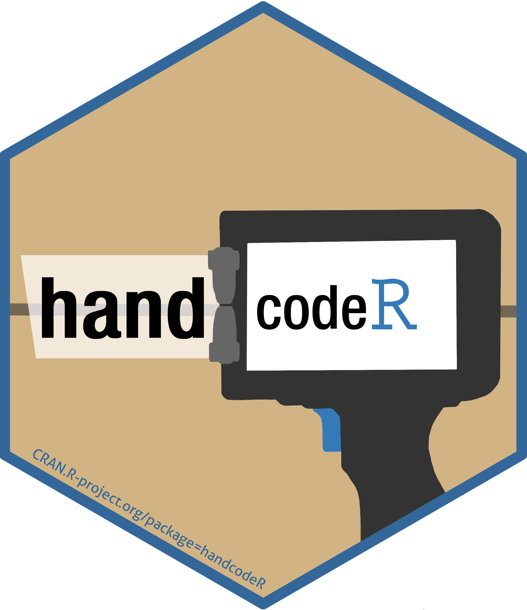
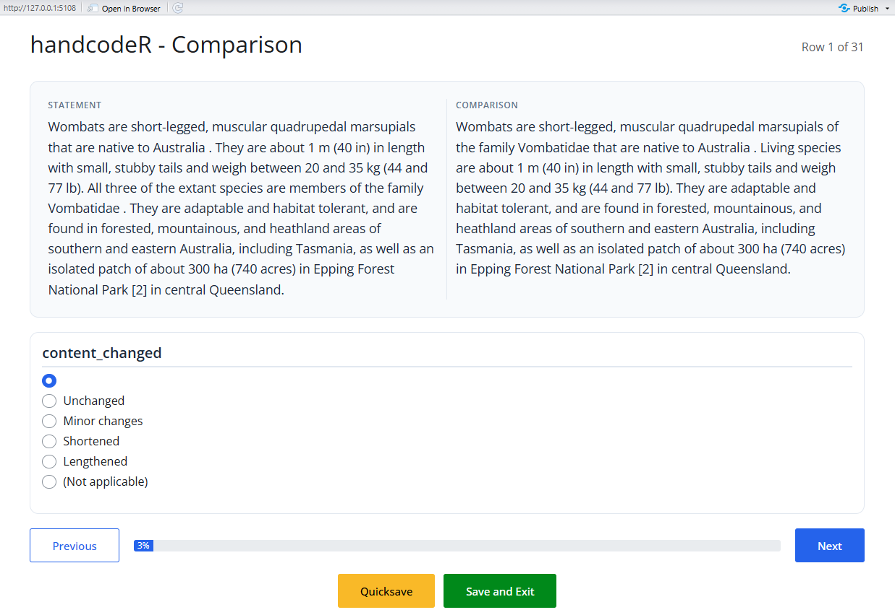
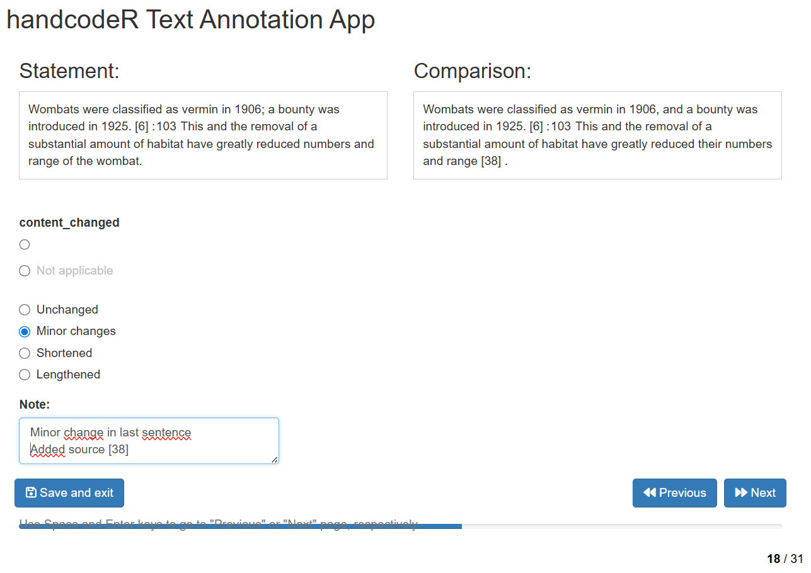

```{css, include = FALSE}
p {
  text-align: justify
}
```

# handcodeR 

[](https://app.codecov.io/gh/liserman/handcodeR)
[](https://cran.r-project.org/package=handcodeR)
[](https://cran.r-project.org/package=handcodeR)
[](https://cran.r-project.org/package=handcodeR)
[](https://cran.r-project.org/package=handcodeR)
[](https://zenodo.org/badge/latestdoi/608736610)

```{r, include = FALSE}
knitr::opts_chunk$set(
  collapse = TRUE,
  warning = FALSE,
  message = FALSE,
  comment = "#>",
  fig.path = "man/figures/",
  out.width = "100%"
)
```


# handcodeR

R-Package to facilitate the annotation of text data by hand in R.


The goal of the handcodeR package is to provide an easy to use app to annotate text data by hand. Often times when we work with text data, we rely on hand coded annotations of texts either as unit of analysis in itself, or as training and test samples for supervised machine learning tools to classify text data. handcodeR offers Shiny-Apps that can be run within R to annotate individual texts one by one. To do so, the package uses two functions:

- `handcode()` opens a Shiny-App which allows for hand-coding strings of text into pre-defined categories. You can code an arbitrary number of variables at a time. It returns a data frame with your coded annotations.

- `quickcode()` opens a Shiny-App which allows for fast hand-coding of a single variable. Every category gets its own button and number key, and the app automatically moves on to the next text once you have made your choice. It returns a data frame with your coded annotations.


I present a short step-by-step guide as well as the functions in more detail below.


## How to cite this package

To cite the handcodeR package, you can use:

> Isermann, Lukas and Klingenspohr, Dennis. (2026). handcodeR: Text annotation app.
> R package version 0.2.1.
> <http://doi.org/10.5281/zenodo.8075100>.

You can also access the preferred citation as well as the bibtex entry for the handcodeR Package via R:

```{r}
citation("handcodeR")
```


## Installation

A stable version of `handcodeR` can be directly accessed on CRAN:

```{R, message = FALSE, warning = FALSE, results = "hide", eval = FALSE}
install.packages("handcodeR", force = TRUE)
```

To install the latest development version of `handcodeR` directly from [GitHub](https://github.com/liserman/handcodeR) use:

```{R, message=FALSE, warning=FALSE, results = "hide", eval=FALSE}
library(devtools) # Tools to Make Developing R Packages Easier
devtools::install_github("liserman/handcodeR", force = TRUE)
```

## How to use this package

First, load the package

```{R, message=FALSE, warning=FALSE}
library(handcodeR) # classify texts by hand in R
```

In the following, we are going to exemplify the workflow of the package using a minimal working example.

The workflow of the package follows a simple rule:

1. If you start the coding process, initialize the coding with `handcode()` or `quickcode()` by providing a text vector of texts you wish to annotate as `data` input, and one or more named character vectors of categories you want to code (exactly one for `quickcode()`). Hand code as much data as you would like and return the output data frame via the `Save and Exit`-button.

2. If you want to resume coding that you have already been working on, continue the coding with the same function by providing the data frame you received as output from your last call as `data` input.


### Example data

In order to demonstrate the functionality of the package, we use the R-package [`archiveRetriever`](https://github.com/liserman/archiveRetriever) to download the paragraphs of the Wikipedia article on Wombats at two different points in time, July 2022 and March 2024. For the basic examples we only need the paragraphs of the older version. The newer version is used later on to compare texts against each other.

```{r download data}
# Install pacman if not already installed
if(!require(pacman)) install.packages("pacman")

# Use pacman to install and load archiveRetriever
pacman::p_load(archiveRetriever)

# Download paragraphs of Wikipedia article on Wombats for July 2022 and March 2024
wombat_1 <- scrape_urls(Urls = "https://web.archive.org/web/20220703070930/https://en.wikipedia.org/wiki/Wombat",
                        Paths = c(text = "//text()"),
                        collapse = "//div[@class='mw-body-content mw-content-ltr']//p")

wombat_2 <- scrape_urls(Urls = "https://web.archive.org/web/20240329193637/https://en.wikipedia.org/wiki/Wombat",
                        Paths = c(text = "//text()"),
                        collapse = "//div[@class='mw-content-ltr mw-parser-output']//p")

# Delete empty first row
wombat_1 <- wombat_1[-1,]
wombat_2 <- wombat_2[-1,]

# Paragraphs we want to annotate
paragraphs <- wombat_1$text

head(paragraphs)
```


### handcode

The main function of the handcodeR package is `handcode()`. `handcode()` takes either a vector of texts and one or more named character vectors with classification categories, or a data frame already initialized by `handcode()` as input. The function allows users to annotate texts using the pre-defined categories in an interactive Shiny-App and returns a data frame of the texts with their annotations.

We can now use the paragraphs as input in `handcode()` to annotate the individual paragraphs of the Wikipedia article. We will annotate two variables measuring the topic a paragraph talks about and whether the paragraph contains numbers or measurements.

```{r, eval = FALSE}
annotated <- handcode(data = paragraphs,
                      topic = c("Anatomy", "Behaviour", "Habitat", "Conservation"),
                      numbers = c("Yes", "No"))
```

<!-- SCREENSHOT PLACEHOLDER: handcode() with the wombat paragraphs (topic, numbers).
     Replace with an updated man/figures/App1.png. -->


We can stop the annotation process at any point by clicking on the button `Save and Exit`. Once we click this button, the app shows a short confirmation, closes, and the function returns a data frame with our texts and annotations.

```{r, echo=FALSE}
annotated <- tidyr::tibble(texts = as.character(paragraphs), topic = factor("", levels = c("", "_Not applicable_", "Anatomy", "Behaviour", "Habitat", "Conservation")), numbers = factor("", levels = c("", "_Not applicable_", "Yes", "No")))

annotated$topic[1:2] <- c("Anatomy", "Habitat")
annotated$numbers[1:2] <- c("Yes", "No")
```

```{r}
annotated
```


We can resume the annotation process at any point by using the returned data frame from our last execution of `handcode()` as input to a new `handcode()` command. By default, the function will resume the annotation at the first text that has not been annotated yet.

```{r, eval = FALSE}
annotated <- handcode(data = annotated)
```


To facilitate the classification process, `handcode()` takes the keyboard shortcuts `space` for `previous` and `enter` for `next`. If you go back to already coded lines of your data, the app automatically displays your previous coding, if you go to new lines of your data, the default values for your variables always are "". If the last row of your data is reached, `next` keeps you on the last row. Your selections are saved continuously, so you can simply click `Save and Exit` to return your data.


### quickcode

If you only want to code one variable, `quickcode()` offers a faster way to do so. Instead of radio buttons, every category of the variable is displayed as its own button with a number key printed underneath. Pressing the number key, or clicking the button, records the category and the app automatically moves on to the next text after a short delay. Only one category can be chosen per text.

```{r, eval = FALSE}
quick_annotated <- quickcode(data = paragraphs,
                             topic = c("Anatomy", "Behaviour", "Habitat", "Conservation"))
```

<!-- SCREENSHOT PLACEHOLDER: quickcode() button grid with the numpad keys.
     Replace with man/figures/AppQuickcode.png once the screenshot exists. -->

The number keys follow the layout of the numpad on your keyboard. Up to five categories are displayed in one row, numbered from left to right. From six categories onwards, the buttons are arranged like the numpad itself, so that the bottom row is always `1`-`2`-`3`:

```
                        --- Textbox ---
[Option 1]  [Option 2]  [Option 3]  [Option 4]  [Option 5]
    [1]         [2]         [3]         [4]         [5]
```

```
              --- Textbox ---
[Option 1]  [Option 2]  [Option 3]
    [7]         [8]         [9]
[Option 4]  [Option 5]  [Option 6]
    [4]         [5]         [6]
[Option 7]  [Option 8]  [Option 9]
    [1]         [2]         [3]
```

`quickcode()` takes between two and nine categories. The missing category sits below the buttons and is always coded with the key `0`. The keyboard shortcuts `space` for `previous` and `enter` for `next` work just as in `handcode()`. Resuming works the same way as well: simply provide the data frame returned by your last call of `quickcode()` as `data` input.


#### Beyond the basics

##### Context

By default (`context = FALSE`), only the paragraph we are currently coding is displayed. If we want to see not only the paragraph we are currently coding, but also the surrounding paragraphs, we can use the option `context = TRUE`. This gives us our current paragraph alongside its previous and following paragraph. To not generate any confusion about which paragraph is currently evaluated, the surrounding paragraphs are shown in gray. With `context = "FLEX"`, the app displays a checkbox that allows you to switch the context on and off while coding.

```{r, eval = FALSE}
annotated <- handcode(data = paragraphs,
                      topic = c("Anatomy", "Behaviour", "Habitat", "Conservation"),
                      numbers = c("Yes", "No"),
                      context = TRUE)
```

<!-- SCREENSHOT PLACEHOLDER: handcode() with context = TRUE on the wombat paragraphs.
     Replace with an updated man/figures/App2.png. -->

If our text vector does not form a continuous text, but you nonetheless want to provide a previous and next text as context, you can also specify a vector with all previous and a vector with all next texts as `pre` and `post` inputs. Supplying `pre` or `post` turns the context display on automatically. If you only supply one of them, only that side of the context is shown.

```{r, eval = FALSE}
# Vectors of all previous and all subsequent paragraphs
previous <- c("", paragraphs[-length(paragraphs)])
subsequent <- c(paragraphs[-1], "")

annotated <- handcode(data = paragraphs,
                      topic = c("Anatomy", "Behaviour", "Habitat", "Conservation"),
                      numbers = c("Yes", "No"),
                      pre = previous,
                      post = subsequent)
```


##### Comparing texts

You can also use handcodeR to compare texts against each other. To do so, provide a second text vector as `comparison` input. Each element of `comparison` is displayed side by side with the corresponding element of `data`. Here, we supply the older version of the Wikipedia article as `data` and the newer version as `comparison` to annotate how each paragraph has changed over time.

```{r, eval = FALSE}
comparison <- handcode(data = wombat_1$text,
                       comparison = wombat_2$text,
                       content_changed = c("Unchanged", "Minor changes", "Shortened", "Lengthened"))
```

```{r, echo=FALSE}

```

As before, you can use the option `context = TRUE` to display the preceding and following text for both inputs. Custom context for the comparison texts can be provided via `pre_comparison` and `post_comparison`, analogous to `pre` and `post`: they also turn the context display on automatically and can be supplied one-sided. Comparing texts works exactly the same with `quickcode()`.


##### Start and order

By default, `handcode()` and `quickcode()` use the first line in the input data that has not been annotated yet as start value. However, the option `start` allows users to specify with which observation they want to start their coding process by providing its row number, e.g. `start = 5`. If we have not yet annotated lines of data that lie between already coded lines of data, you can also specify `start = "all_empty"` to annotate all lines that have not been coded yet in the order in which they appear.

Sometimes, we explicitly want to display texts in a random order to rule out that the context of a text within the larger body of texts influences our annotations. If we want to randomize the order in which texts are displayed, we can set the option `randomize = TRUE`. Only texts that have not been annotated yet are shuffled. This will, however, not influence the order in which texts are sorted in the resulting output.


##### Missing categories

As a default, both functions display one missing category "Not applicable". In `handcode()`, you can provide a character vector of one or more missing categories you would like to have displayed as `missing`. Missing categories are displayed in gray. In the output these values will be returned with a leading and trailing `_`. As `quickcode()` codes missings with the single key `0`, it only takes one missing category.

```{r, eval = FALSE}
annotated <- handcode(data = paragraphs,
                      topic = c("Anatomy", "Behaviour", "Habitat", "Conservation"),
                      numbers = c("Yes", "No"),
                      missing = c("Not applicable", "Undecided"))
```


##### Adding notes

If you want to write down comments or observations alongside your coding, you can set `notes = TRUE`. This adds a text field to the app and an additional `notes` column to the output. The option only needs to be set once at the beginning of a new annotation process. When you resume coding, the information is taken from the data frame provided as `data`. The option works the same way in `quickcode()`.

```{r, eval = FALSE}
comparison <- handcode(data = wombat_1$text,
                       comparison = wombat_2$text,
                       content_changed = c("Unchanged", "Minor changes", "Shortened", "Lengthened"),
                       notes = TRUE)
```

```{r, echo=FALSE}

```


##### Keyboard shortcuts and speed

With `keyboard_shortcuts = TRUE`, `handcode()` lets you code with the number keys as well. The number next to each variable name shows which key belongs to it, and pressing the key cycles through the categories of that variable. This works for up to nine variables.

In `quickcode()`, the delay before the app moves on to the next text can be set via `advance_delay` (in seconds, default `0.7`). With `advance_delay = 0`, the app moves on immediately.


##### Saving your work

However you close the app, by clicking `Save and Exit`, closing the browser tab, or losing the connection to R, the annotated data is returned to your R session. Just make sure to assign the function call to an object.

If you additionally want to save your progress to disk while coding, you can provide the path to an existing folder as `snapshot_dir`. The app then displays a `Save Snapshot` button, which writes a time-stamped `.RData` file of your current annotations to that folder without closing the app. The folder is never created automatically.

```{r, eval = FALSE}
annotated <- handcode(data = paragraphs,
                      topic = c("Anatomy", "Behaviour", "Habitat", "Conservation"),
                      numbers = c("Yes", "No"),
                      snapshot_dir = "my_saves")
```

To resume from a snapshot, load the file and provide the restored data frame as `data` input. The restored object carries the name of your `data` input.

```{r, eval = FALSE}
load("my_saves/paragraphs_snapshot_1714387234.RData")
annotated <- handcode(data = paragraphs)
```
